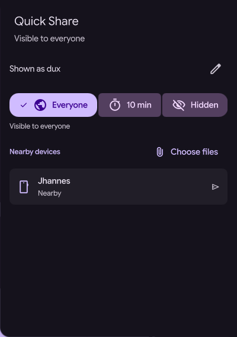

# Quick Share for Dux Shell

Send and receive files, links and text between Linux and Android phones with
Google Quick Share, right from your Dux Shell bar. No app on the phone, no
cloud, no pairing, and the phone and the PC do not need to be on the same
Wi-Fi.

It consists of a Dux Shell plugin and a small native daemon
(`dms-quickshare`, written in Rust) that speaks the Quick Share protocol. The
daemon also has a command line interface, so it works without the shell too.



## Features

- **Receive** files, links, text and shared Wi-Fi networks from Android
  phones. You get a notification with Accept / Decline and the verification
  code the sending phone shows.
- **Send** files, links and text to nearby phones.
- **Your device name and visibility** like on Android: visible to everyone,
  to everyone for 10 minutes, or hidden (sending still works while hidden).
- **No pairing prompts**: phones connect over Bluetooth Low Energy.
- **Fast Wi-Fi transfers, also between different networks.** Bluetooth only
  sets up the connection; the data then moves over Wi-Fi (see
  [How the Wi-Fi part works](#how-the-wi-fi-part-works)). Your own Wi-Fi
  connection is never dropped or changed.
- Received links and text are copied to the clipboard; links open from the
  notification, files open from it or show in their folder.

Tested with Dux Shell 2.1.2 on Arch Linux (Hyprland) and an OPPO Find X9 Pro
(ColorOS 17). Quick Share is part of Google Play Services, so other current
Android phones should behave the same.

## Requirements

- Dux Shell 2.1 or newer (for the plugin; the daemon and CLI run anywhere)
- A Bluetooth adapter with Bluetooth LE and BlueZ (`bluetoothd` running)
- NetworkManager, for fast transfers when phone and PC are on different
  networks
- `iw`, so the daemon can see what your Wi-Fi card supports
- `dnsmasq` and `wpa_supplicant`, for the temporary hotspot the Wi-Fi helper
  runs (`wpa_supplicant` usually comes with NetworkManager, but not on setups
  that use iwd)
- Rust 1.89 or newer to build the daemon

On Arch Linux: `sudo pacman -S --needed rust bluez bluez-utils networkmanager wpa_supplicant iw dnsmasq`

## Installation

**From the plugin registry.** Install Quick Share under Settings > Plugins >
Browse (or `dms plugins install quickshare`), enable it and add its widget to
the bar. Then open it and press **Install**: the plugin builds its background
service (`dms-quickshare`, a Rust program) from its own source code and
installs it to `~/.local/bin`. This needs Rust, no root access, and downloads
nothing besides the Rust crates cargo fetches. The first build takes a few
minutes. After a plugin update, the panel offers to rebuild the service the
same way.

**From source.**

```bash
git clone https://github.com/jhannesreimann/dux-quickshare
cd dux-quickshare
./install.sh
dms restart
```

`install.sh` does the same build and links the plugin into
`~/.config/dms/plugins/`. Then enable **Quick Share** under Settings > Plugins
and add its widget to the bar.

Run `dms-quickshare doctor` to check your setup. It tells you which of the
Wi-Fi modes below your hardware supports and what to fix.

### Optional: the Wi-Fi helper (laptops with one Wi-Fi card)

When the helper would make transfers faster on your PC, the settings page
offers it under Connections (**Install** asks for your password). From a
terminal: `./install.sh --wifi-helper`.

This is the only part that needs root, once, at install time. It installs:

| File | Purpose |
|---|---|
| `/usr/lib/dms-quickshare/wifi-helper` | Creates one extra virtual interface (`qsap0`) on your Wi-Fi card and runs a short-lived, password-protected hotspot on it (its own `wpa_supplicant` in access point mode plus `dnsmasq` for DHCP only: no internet sharing, no DNS, no default route). Also creates `qssta0` on cards that support a second client connection. |
| `/usr/share/polkit-1/actions/io.github.jhannesreimann.dms-quickshare.policy` | Lets the active desktop session run exactly that helper through `pkexec` without a password. Other users, SSH sessions and other programs get no such right. |
| `/usr/lib/udev/rules.d/85-dms-quickshare.rules` | Tells NetworkManager to leave `qsap0` alone. |

Why: a normal user cannot create Wi-Fi interfaces, and NetworkManager cannot
run a hotspot next to an existing connection on the same card. Without the
helper, a laptop with a single Wi-Fi card can only use Wi-Fi when the phone
is on the same network. The helper source is a short, readable shell script
in [`system/wifi-helper`](system/wifi-helper). Remove it with
`./install.sh --remove-wifi-helper`.

### Uninstall

```bash
./install.sh --uninstall          # daemon and plugin link
./install.sh --remove-wifi-helper # only if you installed it
```

Settings stay in `~/.config/dms-quickshare/`.

## Using it

**Bar widget.** The icon shows your state: visible, hidden, an incoming
request, or the progress of a running transfer. Click it to open the panel:

- your device name (click the pen to change it) and visibility: Everyone,
  everyone for a few minutes, or Hidden
- incoming requests with Accept / Decline and the verification code
- running transfers with progress and a cancel button
- nearby devices: click one to choose files and send, or choose files first
  with "Choose files" and then click the device
- recent transfers: click to open, or show them in their folder

Drop files onto the bar icon or the panel to send them.

**Control Center.** Add the Quick Share tile to switch between visible and
hidden, like the Android quick setting.

**Settings** (Settings > Plugins > Quick Share): device name, visibility and
its duration, download folder, accepting without asking, notifications, and
which connections to use (Bluetooth, local network, fast Wi-Fi transfers,
short Wi-Fi interruption).

**On the phone**, open the share sheet, choose Quick Share and pick your PC.
To send to the phone, open Quick Share on it so it is visible.

**Keybindings and scripts** can use the shell's IPC:

```bash
dms ipc call quickshare visibility everyone   # everyone, temporary, hidden
dms ipc call quickshare toggle                 # visible <-> hidden
dms ipc call quickshare send "/path/to/file"   # opens the panel to pick a device
dms ipc call quickshare status
```

The plugin is available in English and German.

### Command line

```text
dms-quickshare daemon                     Run the background service (the plugin does this)
dms-quickshare status                     Name, visibility, radios, transfers
dms-quickshare devices [SECONDS]          List nearby devices
dms-quickshare send [--to NAME] FILE...   Send files (without --to: pick in the shell)
dms-quickshare send --to NAME --text TEXT Send a text or link
dms-quickshare visibility [everyone|temporary|hidden]
dms-quickshare name [NEW NAME]            Show or change the device name
dms-quickshare accept|reject|cancel ID    Answer or stop a transfer
dms-quickshare bluetooth-on               Switch Bluetooth on
dms-quickshare doctor                     Check the system setup
```

### Configuration file

The settings page and the CLI edit `~/.config/dms-quickshare/config.json`:

| Key | Default | Meaning |
|---|---|---|
| `deviceName` | your PC model | Name shown on phones |
| `visibility` | `everyone` | `everyone`, `temporary` or `hidden` |
| `temporaryMinutes` | `10` | How long `temporary` visibility lasts |
| `downloadDir` | XDG download folder | Where received files go |
| `autoAccept` | `false` | Accept incoming transfers without asking |
| `useBluetooth` / `useWifi` | `true` | Allowed transports |
| `autoEnableBluetooth` | `true` | Power the adapter on at start when visible (never lifts an rfkill block) |
| `notifications` | `true` | Desktop notifications |
| `wifiUpgrade` | `true` | Move transfers to Wi-Fi when possible |
| `wifiInterrupt` | `false` | On cards that cannot run a second link: briefly leave your Wi-Fi network for a fast transfer, then reconnect |
| `port` | `0` | TCP port for incoming connections; `0` picks a free one at each start |

## How the Wi-Fi part works

Phones find the PC over Bluetooth LE (and over mDNS on a shared network). The
connection starts over Bluetooth LE or the local network, and then moves to
the fastest Wi-Fi link both sides can use, while the transfer keeps running:

| Your setup | What happens | Speed in tests |
|---|---|---|
| Phone and PC on the same network | Direct connection over that network | 60 MB in 7 s |
| Different networks, PC has a second, idle Wi-Fi adapter | The PC joins the phone's Wi-Fi Direct group with it; the phone stays on its Wi-Fi | 60 MB in 17 s including tapping Accept |
| Different networks, one Wi-Fi card that supports a second client connection, helper installed | Same as above, on a virtual interface of that card | not tested yet |
| Different networks, one Wi-Fi card that supports a hotspot next to the connection (most current cards), helper installed | The PC opens a temporary hotspot on its current channel; the phone joins it for the transfer | 60 MB in 12 s |
| Different networks, none of the above | Bluetooth only (about 20 KB/s), or a short Wi-Fi interruption if `wifiInterrupt` is on | |

Speeds are from the tests in [TESTING.md](TESTING.md), measured from
accepting until the file was complete unless noted.

The PC keeps its own Wi-Fi connection in every mode except the opt-in
`wifiInterrupt`.

## Privacy and security

- Nothing leaves your local radio range: no internet access, no accounts, no
  telemetry. Discovery uses Bluetooth LE and mDNS on your local network.
- Connections are end-to-end encrypted with Quick Share's UKEY2 key exchange
  (AES-256 and HMAC-SHA256). Temporary Wi-Fi links use WPA2 with a random,
  single-use password exchanged over that encrypted channel. When the phone
  hosts a Wi-Fi Direct group, Quick Share turns off its second encryption
  layer on that link (the phone decides this; the WPA2 link encryption
  stays). The daemon only accepts such frames on an upgraded Wi-Fi link.
- Incoming transfers always need your consent, unless you turn on
  `autoAccept`. Compare the code on the notification with the one on the
  phone.
- The daemon writes only to your download folder, `~/.config/dms-quickshare/`
  and its socket in `$XDG_RUNTIME_DIR`.
- Bluetooth Classic is only used when the PC sends, or as a fallback when
  Bluetooth LE connections are unavailable. If a phone connects over
  Bluetooth Classic and asks for a "Just Works" pairing, the daemon accepts
  it only while you are visible and a phone just read the Quick Share
  advertisement, and removes that pairing again after the transfer. Devices
  you paired yourself are never touched.

## Troubleshooting

Start with `dms-quickshare doctor`.

- **The PC does not show up on the phone**: check that you are visible and
  Bluetooth is on (`dms-quickshare status`). Phones cache results for a while;
  closing and reopening the share sheet helps.
- **Slow transfers between different networks**: see the table above. Run
  `doctor` to see which mode your hardware supports and whether the Wi-Fi
  helper would help.
- **"No Wi-Fi country set"**: without a regulatory domain the kernel only
  allows hotspots on a few narrow channels. Install `wireless-regdb` and set
  your country, for example `WIRELESS_REGDOM="DE"` in
  `/etc/conf.d/wireless-regdom` (Arch), then reboot.
- **The phone leaves its Wi-Fi while Quick Share is open**: phones with
  Google's AirDrop compatibility (the "Mosey" component) disconnect from
  Wi-Fi networks on the same band while sharing. That is the phone's
  behaviour; the transfer still works.
- **Firewall**: set a fixed `port` in the config file, then allow that TCP
  port and UDP 5353 (mDNS). For the hotspot mode also allow DHCP (UDP 67) on
  the `qsap0` interface.

## iPhone / AirDrop

Not supported. AirDrop uses Apple's own Wi-Fi link layer (AWDL), which Linux
can only run on some Wi-Fi cards, in monitor mode and with root. The AirDrop
support in Quick Share on Android phones runs on the phone itself and is
closed source; it does not help a PC. For iPhones, look at the
[AirDrop plugin](https://github.com/Kratospidey/dms-airdrop) in the Dux
plugin registry, which uses [Owly](https://github.com/t4t5/owly) and needs a
supported Wi-Fi card.

## Development

```bash
cd daemon
cargo test
RUST_LOG=debug cargo run -- daemon
```

See [TESTING.md](TESTING.md) for the test matrix and how to test with a phone.

The protocol implementation follows Google's open source
[Nearby Connections](https://github.com/google/nearby) code and the work of
[NearDrop](https://github.com/grishka/NearDrop) and
[rquickshare](https://github.com/Martichou/rquickshare).

## License

MIT
